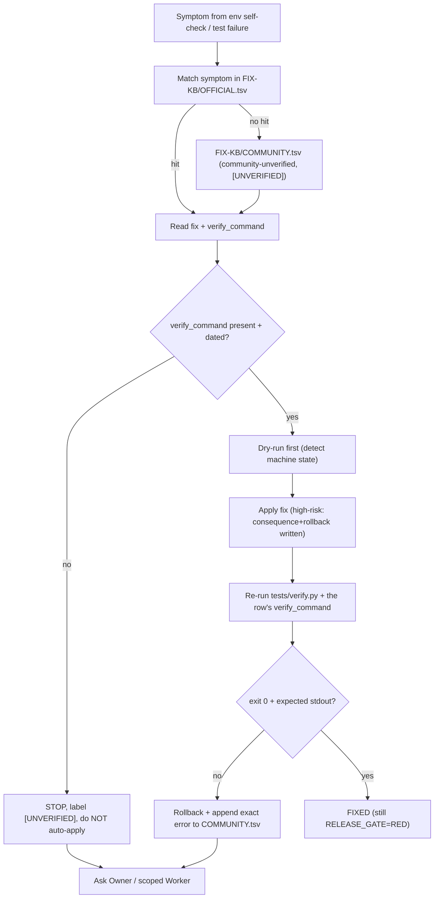

OWNER: parent (took over stalled PackageDesign slice) | package/SELF-REPAIR.md
# SELF-REPAIR — tool / environment self-diagnosis loop

## Invariants (from S1/S2, 2026-10-28, and S17/S23, 2026-11-11)
- **Detect before apply**: print the machine/tool state first (VCC_I18N), then `dry-run`, then `-Apply` (bootstrap.ps1). Never silent-install drivers.
- **High-risk** (drivers / Npcap / Defender / samples): write consequence + rollback BEFORE acting; if no rollback, STOP.
- **Every fix needs a verify command** with exit + stdout; a fix with no verify command is `[UNVERIFIED]` and must not be auto-applied (FIX-KB-DESIGN negative control).
- **No credential output**, no raw corpora, no `.jsonl`, no THINK, no PRIVATE visibility change, no `vrc-dcc` restore.
- **RED-gate honesty**: a repaired tool does NOT turn `RELEASE_GATE=GREEN`; 268 blockers / 0/27 strict receipts stand.

## Loop (one form: mermaid flow, no duplicate SVG)

## Symptom taxonomy (windows-agent-doctor S17, 2026-11-11)
`shell` (bash vs PowerShell vs timeout.exe), `encoding` (`python -X utf8`, CJK TSV), `glob` (junction / path separators), `exit codes` (negation-regex false positives, P09), `tool freshness` (manifest + version + hash, S2 checklist 2).

## Official vs community
- OFFICIAL.tsv: HEAD files / AGENTS.md / prior receipts / official README — `official-verified`.
- COMMUNITY.tsv: issues / forum / cross-harness observations — `community-unverified` + `[UNVERIFIED]` + date. Never use a community row to justify a remote write or visibility change.

## Verify
`tests/verify.py` asserts every FIX-KB row has a `verify_command`; a crafted empty-verify row makes the checker RED in memory (no file write).
